<div align="center">

<h1>Jacob Adm<br><sub><sub>AI Automation Engineer</sub></sub></h1>

<p><a href="https://www.linkedin.com/in/jacobadm"></a>&nbsp;<a href="https://github.com/jacob-adm/homebrew-tap"></a>&nbsp;&nbsp;</p>

Tools for QA, agent harnesses and DevOps toolchains.

<b><a href="#01-agent-harness">Agent harness</a>&emsp;<a href="#02-devops-toolchain">DevOps toolchain</a>&emsp;<a href="#03-mobile">Mobile</a>&emsp;<a href="#04-research">Research</a>&emsp;<a href="#status-and-limits">Status and limits</a></b>

</div>

<br>

<picture><source media="(prefers-color-scheme: dark)" srcset="assets/dark/flow.svg">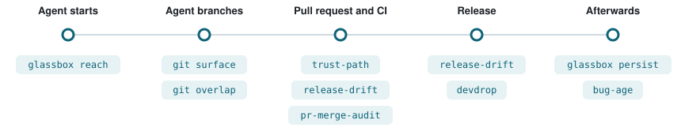</picture>

The command-line tools run unattended, in a CI job, a git hook or an agent harness. Each documents its exit statuses, so a non-zero exit fails a check or stops an agent. trust-path, release-drift, git-surface, git-overlap, glassbox and devdrop print JSON with `--json`, pr-merge-audit with `report --json`, and bug-age prints JSON by default. git-surface and git-overlap write tab-separated records by default, so they can feed each other in a pipeline.

<h2 id="01-agent-harness"><picture><source media="(prefers-color-scheme: dark)" srcset="assets/dark/g1.svg"></picture></h2>

<p>
<a href="https://github.com/jacob-adm/glassbox"><picture><source media="(prefers-color-scheme: dark)" srcset="assets/dark/glassbox.svg">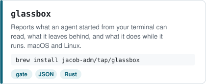</picture></a>
<a href="https://github.com/jacob-adm/ai-automation-engineer-workstation"><picture><source media="(prefers-color-scheme: dark)" srcset="assets/dark/workstation.svg">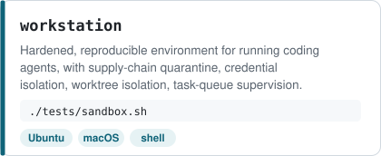</picture></a>
</p>

<details>
<summary><b>Wire it into an agent harness</b></summary>

Gate the start of an agent on what it could read.

```sh
glassbox reach --strict --json > reach.json && my-agent
```

The agent starts only when no sensitive location, such as SSH keys or cloud credentials, is readable.

Check what an agent session left behind in launch agents, startup files, git hooks, git config and agent configurations.

```sh
glassbox persist --repo . --save before.snapshot
my-agent
glassbox persist --repo . --since before.snapshot --strict
```

Before an agent's branch is pushed or merged, the same CI checks run locally. `echo HEAD | git surface main` reports what runs or is trusted, and `trust-path --ref HEAD` checks the workflows on that branch.

<details>
<summary><b>Branch triage pipeline</b> with one list of agent branches through git-surface and git-overlap</summary>

<br>

```sh
git for-each-ref --format='%(refname:short)' refs/heads/agent/ > branches
git surface main < branches                        # which branches touch code that runs or is trusted
git footprint main < branches | git overlap | git pairmerge --onto main   # which pairs conflict
```

`git pairmerge` needs git 2.43 or later.

Follow up on what git-surface reports.

- For a `ci` record, run `trust-path --ref <branch>` to check whether the changed workflow exposes a secret to untrusted text.
- For a `deps` record, download both versions of the dependency into two existing directories with `release-drift fetch pypi NAME VERSION DIR` (or `npm`), then compare them with `release-drift diff OLD NEW`.
- git-overlap predicts conflicts from the files each branch changes. pr-merge-audit then confirms them by merging the pull requests and running the tests.

</details>

These stacks are shell pipelines. There is no single command or packaged CI action that runs them. The tested stacks, with their real output, are in [git-surface with other tools](https://github.com/jacob-adm/git-surface/blob/main/docs/other-tools.md) and [glassbox with other tools](https://github.com/jacob-adm/glassbox/blob/main/docs/integration.md).

</details>

<details>
<summary><b>Run the workstation</b></summary>

<br>

- Try it without changing your machine. `./tests/sandbox.sh` opens a throwaway Ubuntu 24.04 container.
- Use it every day on Ubuntu 22.04 or 24.04, on a PC, a VM, WSL2 or a cloud server.
- Use it on a headless cloud GPU server with `./install.sh --profile cloud`.

</details>

<h2 id="02-devops-toolchain"><picture><source media="(prefers-color-scheme: dark)" srcset="assets/dark/g2.svg"></picture></h2>

<p>
<a href="https://github.com/jacob-adm/git-surface"><picture><source media="(prefers-color-scheme: dark)" srcset="assets/dark/git-surface.svg">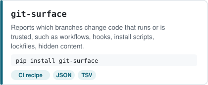</picture></a>
<a href="https://github.com/jacob-adm/git-overlap"><picture><source media="(prefers-color-scheme: dark)" srcset="assets/dark/git-overlap.svg">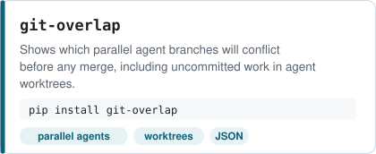</picture></a>
<a href="https://github.com/jacob-adm/trust-path"><picture><source media="(prefers-color-scheme: dark)" srcset="assets/dark/trust-path.svg">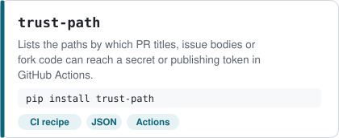</picture></a>
<a href="https://github.com/jacob-adm/pr-merge-audit"><picture><source media="(prefers-color-scheme: dark)" srcset="assets/dark/pr-merge-audit.svg">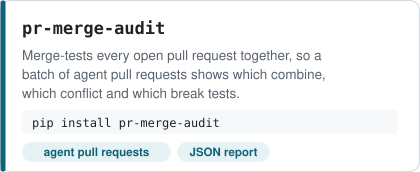</picture></a>
<a href="https://github.com/jacob-adm/release-drift"><picture><source media="(prefers-color-scheme: dark)" srcset="assets/dark/release-drift.svg">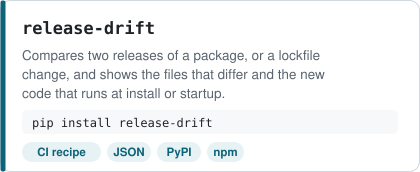</picture></a>
</p>

<details>
<summary><b>Wire them into CI</b> with what fails each check and the recipe</summary>

<br>

| Tool | The check fails when | Recipe |
|:--|:--|:--|
| [git-surface](https://github.com/jacob-adm/git-surface) | the pull request changes CI, hooks, agent instructions, install scripts, dependencies, executables or hidden content | [GitHub Actions and pre-push hook](https://github.com/jacob-adm/git-surface/blob/main/docs/ci.md), tested |
| [trust-path](https://github.com/jacob-adm/trust-path) | the pull request adds a path from untrusted input to a secret or credential. Paths already on the base branch do not fail it | [GitHub Actions](https://github.com/jacob-adm/trust-path/blob/main/docs/ci.md) |
| [release-drift](https://github.com/jacob-adm/release-drift) | a lockfile change upgrades a package with a finding, or a package cannot be compared | [GitHub Actions and pre-commit hook](https://github.com/jacob-adm/release-drift/blob/main/docs/ci.md) |
| [git-overlap](https://github.com/jacob-adm/git-overlap) | two branches share a path or do not merge cleanly | [Recipes](https://github.com/jacob-adm/git-overlap/blob/main/docs/recipes.md) |
| [pr-merge-audit](https://github.com/jacob-adm/pr-merge-audit) | a script reads `result` and `merged` in `report --json` and finds a pull request that does not merge or pass tests | [Commands](https://github.com/jacob-adm/pr-merge-audit/blob/main/docs/commands.md) |
| [devdrop](https://github.com/jacob-adm/devdrop) | any selected device is not `ok`. `--junit FILE` gives one testcase per device | [Reports for CI](https://github.com/jacob-adm/devdrop/blob/main/docs/ci.md) |

</details>

<details>
<summary><b>Versions and install</b></summary>

<br>

| Stage | Question | Tool | Install | Version |
|:--|:--|:--|:--|:--|
| Before an agent runs | What can this process read, write and reach on this machine? | [glassbox](https://github.com/jacob-adm/glassbox) | `brew install jacob-adm/tap/glassbox` | <a href="https://github.com/jacob-adm/glassbox/releases/latest"></a> |
| Branches pile up | Which branches change workflows, hooks, install scripts, lockfiles or hidden content? | [git-surface](https://github.com/jacob-adm/git-surface) | `pip install git-surface` | <a href="https://pypi.org/project/git-surface/"></a> |
| | Which branches will conflict with each other, including uncommitted work in worktrees? | [git-overlap](https://github.com/jacob-adm/git-overlap) | `pip install git-overlap` | <a href="https://pypi.org/project/git-overlap/"></a> |
| Before merge | Can PR titles, issue bodies or fork code reach a secret or publishing token in GitHub Actions? | [trust-path](https://github.com/jacob-adm/trust-path) | `pip install trust-path` | <a href="https://pypi.org/project/trust-path/"></a> |
| | Do all open pull requests merge and pass tests together? | [pr-merge-audit](https://github.com/jacob-adm/pr-merge-audit) | `pip install pr-merge-audit` | <a href="https://pypi.org/project/pr-merge-audit/"></a> |
| Dependencies and releases | What changed between two releases, and what new code runs at install or startup? | [release-drift](https://github.com/jacob-adm/release-drift) | `pip install release-drift` | <a href="https://pypi.org/project/release-drift/"></a> |
| Afterwards (any project) | How long did fixed bugs live, in commits, days and releases? | [bug-age](https://github.com/jacob-adm/bug-age) | `pip install bug-age` | <a href="https://pypi.org/project/bug-age/"></a> |

</details>

<h2 id="03-mobile"><picture><source media="(prefers-color-scheme: dark)" srcset="assets/dark/g3.svg"></picture></h2>

<p>
<a href="https://github.com/jacob-adm/devdrop"><picture><source media="(prefers-color-scheme: dark)" srcset="assets/dark/devdrop.svg">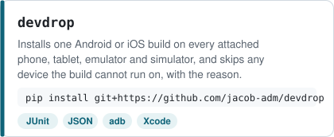</picture></a>
</p>

<details>
<summary><b>What devdrop is for</b></summary>

<br>

It checks each device before installing and skips any device the build cannot run on, with the reason, such as minimum SDK or iOS version, CPU architecture, simulator build versus device build, and provisioning profile. It is tested on emulators, simulators and a physical iPhone.

- Use it to try a release candidate on every device on the desk with one command.
- Use it to boot a set of emulators and simulators, install, launch and collect launch logs.
- Use it in CI. `--json` and `--junit FILE` report each device's result.

</details>

<h2 id="04-research"><picture><source media="(prefers-color-scheme: dark)" srcset="assets/dark/g4.svg"></picture></h2>

<p>
<a href="https://github.com/jacob-adm/bug-age"><picture><source media="(prefers-color-scheme: dark)" srcset="assets/dark/bug-age.svg">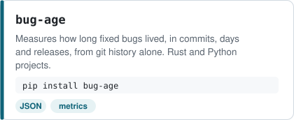</picture></a>
<a href="field-study.md"><picture><source media="(prefers-color-scheme: dark)" srcset="assets/dark/studies.svg">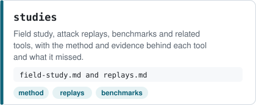</picture></a>
</p>

<details>
<summary><b>All studies</b></summary>

<br>

When several agents work on one repository at once, branches pile up quickly, collide in the same files, and sometimes change code that runs or is trusted, such as workflows, hooks, install scripts and dependencies.

Tools for each of these problems already exist, but they are spread across many projects. These tools attempt to fill the gaps that remained, and most of them can be chained together.

Each tool was then checked against the tools already available, in a field study. glassbox came directly out of one, a study of the Sysinternals Suite. The method was documentation, real use, testing, licence compliance and attribution, with no reverse engineering. The [field study](field-study.md) gives the method and findings, and [related tools](related-tools.md) shows other projects alongside these, for comparison.

| Study | What it covers |
|:--|:--|
| [Field study](field-study.md) | Method and findings, with prior art for every tool and where the gaps were |
| [Replaying the 2026 attacks](replays.md) | Five real supply-chain attacks from 2026, seven releases in all, replayed against trust-path and release-drift, then release-drift against 121 attack samples it had not been tuned on, with what each tool reported, what it missed and what was fixed |
| [Related tools](related-tools.md) | Other projects alongside these, with what each covers and how they were tested |
| [Sysinternals Suite study](https://github.com/jacob-adm/glassbox/blob/main/docs/suite-study.md) | All 79 Suite tools, with licence position and which concepts carry over to macOS, Linux and agent tooling |
| [Feasibility and prior art](https://github.com/jacob-adm/glassbox/blob/main/docs/feasibility.md) | Each glassbox candidate checked against existing projects, with a decision to build, skip or adopt |
| [Merging and CI for agent workflows](https://github.com/jacob-adm/git-overlap/blob/main/docs/article.md) | Xuchen Yao's article mapped point by point to git-overlap and pr-merge-audit |
| [How long do bugs live?](https://github.com/jacob-adm/bug-age/blob/main/article/ARTICLE.md) | Bug lifespans in two Rust codebases, every figure checked against the data |
| [trust-path benchmark](https://github.com/jacob-adm/trust-path/blob/main/docs/benchmark.md) | Pinned public repositories, with zizmor's findings shown per workflow file |

</details>

## Status and limits

- **New.** All eight were first published in November 2026 and have been tested on demo and public repositories.
- **trust-path** covers ground that zizmor, poutine, octoscan and Gato-X also cover. Its benchmark shows where it and zizmor report the same findings and where they differ. Some of those differences may belong upstream rather than in a separate tool. Replayed against the TanStack worm of May 2026, it missed the attack until 0.6.0, which follows pull request code through the Actions cache.
- **release-drift** checks PyPI and npm releases. Replayed against six malicious package releases from 2026, version 0.1.2 reported five and 0.2.0 reports all six. See [Replaying the 2026 attacks](replays.md). On 119 attack samples from 2026 it had not been tuned on, it reported 114. On ordinary releases it stops about 1 in 10 single-version updates of popular packages, 1 in 5 to 1 in 3 for wheels, larger version jumps and less popular packages, and 2 in 5 for less popular PyPI packages. Most of those stops are changed build scripts, rebuilt binaries and new dependencies ([measurement](https://github.com/jacob-adm/release-drift/blob/main/docs/noise.md)).
- **git-overlap** reports textual conflicts only. Symbol-level overlap, a merge order and a live view are in Grove, not here.
- **bug-age** measures any Rust or Python project after the fact. Nothing in it is specific to AI agents.
- **glassbox** runs on macOS and Linux. It reports what a process can reach and does not enforce anything. Pair it with a sandbox for that.
- **devdrop** is tested on emulators, simulators and a physical iPhone, not yet on physical Android devices or iPads. It is not on PyPI.

<sub>Browse by topic
[supply-chain-security](https://github.com/search?q=user%3Ajacob-adm+topic%3Asupply-chain-security&type=repositories)&emsp;
[security-tools](https://github.com/search?q=user%3Ajacob-adm+topic%3Asecurity-tools&type=repositories)&emsp;
[git-tools](https://github.com/search?q=user%3Ajacob-adm+topic%3Agit-tools&type=repositories)&emsp;
[ai-agents](https://github.com/search?q=user%3Ajacob-adm+topic%3Aai-agents&type=repositories)&emsp;
[mobile](https://github.com/search?q=user%3Ajacob-adm+topic%3Amobile&type=repositories)</sub>
